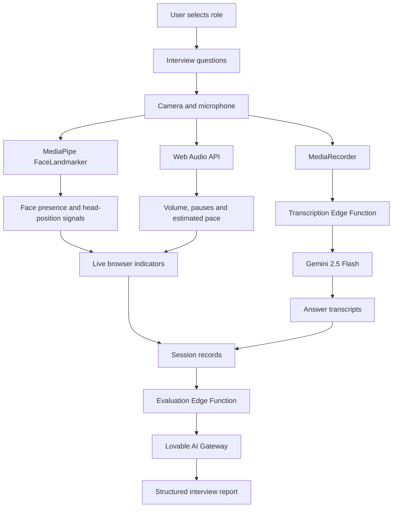

<div align="center">

<!-- ANIMATED BLACK & GOLD HERO -->


<a href="https://hireesense.lovable.app">

</a>
<a href="https://github.com/Sumaya04122006/Hiresense-ai">

</a>

<br/><br/>


<br/>

**An AI-powered interview practice experience that looks beyond the words.**

Practice role-specific interviews, observe live speaking and face-position indicators, and receive a structured AI review of your session.

<br/>


</div>

---

## ◈ The idea

An interview is not just a collection of answers.

Your explanation, pacing, pauses, vocal delivery, and on-camera presentation can all affect how your response comes across. Yet many interview preparation tools focus primarily on answer content.

**HireSense AI explores a more complete approach to interview practice.**

It combines browser-based audio and face-position signals with speech transcription and a final AI review, helping users reflect on both what they said and how they delivered it.

> Practice the answer. Observe the delivery. Learn what to improve.

---

## ◈ Experience the workflow

<div align="center">

| 01 · CONFIGURE | 02 · PRACTICE | 03 · REVIEW |
|:---:|:---:|:---:|
| Choose a role or enter a custom one | Answer questions using your microphone and camera | Receive a structured review of your session |
|  |  |  |

</div>

### 01 — Choose your interview

Select one of the curated roles or enter a custom role to generate a relevant interview question.

### 02 — Speak and observe

During your response, browser-based analysis provides indicators related to:

- Speaking volume
- Estimated speaking pace
- Pauses
- Face presence in the camera frame
- Head position and movement
- Potential look-aways based on face position

These indicators are intended to help users notice delivery patterns while practicing.

### 03 — Receive your review

Each response is transcribed. After the interview, the application sends session information for a structured AI evaluation.

The report can include:

- Overall score
- Strengths and weaknesses
- Answer-content feedback
- Delivery observations
- Practical improvement suggestions
- A rewritten version of the weakest answer

The goal is not simply to assign a score. It is to turn an interview practice session into a useful improvement plan.

---

## ◈ What makes HireSense different?

<details>
<summary><b>01 · Live delivery signals</b></summary>

The browser analyzes audio levels and face landmarks while the user answers.

This allows the interface to display immediate indicators without making an AI request for every live update.

**Engineering distinction:** the real-time signals are computed locally; they are not live judgments generated by an LLM.

</details>

<details>
<summary><b>02 · Whole-session evaluation</b></summary>

The final review considers the collected transcripts and available delivery summaries across the session, rather than evaluating only an isolated answer.

This is designed to make feedback more useful for identifying recurring patterns.

</details>

<details>
<summary><b>03 · Feedback grounded in measured signals</b></summary>

The evaluation instructions are designed to discourage unsupported claims about confidence, emotion, or presentation.

The application provides measurable indicators as context, but those signals cannot reliably establish a person's emotional state or overall interview ability.

</details>

<details>
<summary><b>04 · Low-friction access</b></summary>

The application is designed to be usable without creating an account.

Users can open the live demo and start practicing, subject to browser compatibility and camera or microphone permissions.

</details>

<details>
<summary><b>05 · Privacy-conscious processing</b></summary>

Audio and video analysis for live indicators happens in the browser. Video is not uploaded to the server according to the current design.

Recorded answer audio is sent for transcription, while the final evaluation uses session information.

See the privacy and data-flow section below for the important distinction between local analysis and server-side AI processing.

</details>

---

## ◈ Supported interview roles

The current experience includes curated questions for the following roles, plus a custom-role option.

<div align="center">


</div>

Each curated role has 20 questions available in the question set. Users can practice up to 20 questions in a session.

---

## ◈ System architecture

The application separates low-latency browser analysis from cloud-based transcription and final evaluation.



<sub>Architecture reflects the described application design. Actual deployment behavior should be verified against the current implementation.</sub>

---

## ◈ Under the hood

| Layer | Technology | Responsibility |
|---|---|---|
| Application | TanStack Start, React 19, Vite 7 | User interface and application framework |
| Styling | Tailwind CSS v4, shadcn/ui | Components and interface styling |
| Audio analysis | Web Audio API, `AnalyserNode` | RMS-based volume and audio-level analysis |
| Face analysis | MediaPipe Tasks Vision, `FaceLandmarker` | Face landmarks and position-derived indicators |
| Recording | `MediaRecorder` | Capturing answer audio in WebM format |
| Cloud backend | Lovable Cloud, Supabase Edge Functions | Server-side application operations |
| Runtime | Deno | Edge function execution |
| AI integration | Lovable AI Gateway | Model access |
| Model | `google/gemini-2.5-flash` | Transcription and structured evaluation |
| Hosting | Lovable | Application deployment |

### Edge functions

| Function | Purpose |
|---|---|
| `generate-question` | Generates a question for a custom interview role |
| `transcribe-audio` | Transcribes recorded answer audio |
| `evaluate-answer` | Produces a structured evaluation using constrained tool-calling output |

The evaluation response is designed around fields such as:

`score` · `content` · `delivery` · `improvedAnswer` · `suggestions`

---

## ◈ The live-analysis pipeline

```text
MICROPHONE
    │
    ├──► Web Audio API
    │       ├── RMS volume
    │       ├── Speaking threshold
    │       ├── Pause indicators
    │       └── Estimated words per minute
    │
    └──► MediaRecorder
            └──► Recorded answer audio
                     └──► Transcription service

CAMERA
    │
    └──► MediaPipe FaceLandmarker
              ├── Face presence
              ├── Head-position changes
              └── Position-based look-away indicator

SESSION DATA
    │
    └──► Final evaluation request
              └──► Structured AI feedback
```

**Key architectural decision:** live indicators use browser-side calculations rather than continuous LLM calls. Cloud AI is reserved for transcription and the final evaluation workflow.

---

## ◈ Honest limitations

No sugar-coating: these indicators are useful practice aids, not precise measurements of interview performance.

- **Speaking pace is estimated.** It uses a timing and syllable heuristic rather than verified live speech recognition.
- **Look-away is not eye tracking.** The indicator is based on face or nose landmark position, not a reliable measurement of eye gaze.
- **Speaking detection is threshold-based.** Background noise can be misclassified as speech, while quiet speech may be missed.
- **Transcription can make mistakes.** Gemini 2.5 Flash is used for transcription; results can be affected by accent, noise, and recording quality.
- **AI feedback can be wrong.** A structured report is still model-generated and may miss context or offer imperfect suggestions.
- **Scores are not objective hiring predictions.** They should be treated as practice feedback, not a measure of a candidate's actual employability or professional worth.
- **Browser compatibility matters.** Camera access, microphone access, recording support, and device performance can affect the experience.

These limitations are part of the engineering problem, not details to hide from users.

---

## ◈ Privacy & data flow

Privacy claims need to distinguish local processing from cloud processing.

- **Live video analysis:** face-landmark analysis runs in the browser; the described design does not upload video for server-side processing.
- **Audio transcription:** recorded answer audio is sent to the transcription service.
- **Final evaluation:** transcripts and collected session signals are sent for the final AI review.
- **Storage:** the application is designed not to retain interview media, but actual retention also depends on implementation, logs, service configuration, and provider policies.

Do not enter sensitive personal information into practice answers. Review the live application's privacy disclosures before using it with real interview material.

---

## ◈ Future improvements

Potential next steps for making HireSense AI more reliable and useful:

- [ ] Replace heuristic speaking-pace estimation with transcript-aligned timing.
- [ ] Improve speech detection in noisy environments.
- [ ] Distinguish head orientation from actual eye gaze more carefully.
- [ ] Add question-by-question progress and session summaries.
- [ ] Track recurring feedback patterns across practice sessions, with explicit user consent.
- [ ] Add evaluation calibration and clearer scoring rubrics.
- [ ] Expand interview question sets and role-specific evaluation criteria.
- [ ] Test accessibility, device compatibility, and privacy behavior systematically.

These are proposed improvements, not claims that the features are already implemented.

---

## ◈ About the project

HireSense AI explores how browser-based signal processing and generative AI can work together to create a more complete interview-practice experience.

Built by **Sumaya Fathima**, an Information Technology undergraduate specializing in Artificial Intelligence at Liwa University, Abu Dhabi, UAE.

<div align="center">

<a href="https://hireesense.lovable.app">

</a>

<a href="https://github.com/Sumaya04122006">

</a>

<a href="https://www.linkedin.com/in/sumaya-fathima-7148063a9">

</a>

<br/><br/>


**Better practice. Clearer feedback. More intentional improvement.**

<sub>HireSense AI · AI-assisted interview practice</sub>

</div>
